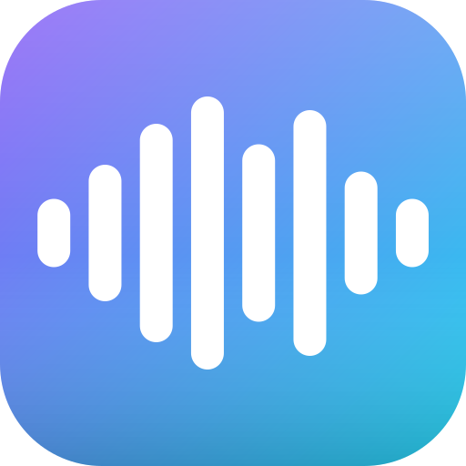

<p align="center">
  
</p>

# StreamBoard – Plugin soundboard pour Stream Deck

🌐 [English](README.md) · **Français**

Transformez votre Stream Deck en soundboard : jouez des fichiers audio locaux ou des URL directes, choisissez la sortie audio, réglez le volume et définissez le comportement de chaque touche.

## 📖 Documentation

[English](docs/en.md) · [Français](docs/fr.md) · [Español](docs/es.md) · [Italiano](docs/it.md) · [Deutsch](docs/de.md) · [Nederlands](docs/nl.md)

## Fonctionnalités

- Lecture de **fichiers audio locaux** (MP3, WAV, FLAC, OGG, AIFF) ou d'**URL directes**
- Les sons venant d'une URL sont téléchargés une seule fois, mis en cache et **préchargés** dès que la touche apparaît : le premier appui joue le son immédiatement
- **Volume** par touche (0–100 %)
- **Sortie audio** commune à toutes les touches, sous Windows et macOS : modifiez-la sur n'importe quelle touche et toutes les touches (y compris les nouvelles) la suivent (par exemple pour envoyer vos sons vers votre casque ou vers un câble virtuel pour votre stream)
- Quatre **modes de touche** :

  | Mode | Comportement |
  |------|--------------|
  | Play / Stop | Un appui joue le son, un nouvel appui l'arrête |
  | Play / Overlap | Chaque appui lance une nouvelle copie du son par-dessus les autres |
  | Play / Restart | Chaque appui relance le son depuis le début |
  | Loop / Stop | Un appui joue le son en boucle, un nouvel appui l'arrête |

- Un **cadre vert** indique les touches dont le son est en cours de lecture
- Une action **Stop** qui arrête tous les sons joués par le plugin

## Installation

### Depuis le Marketplace Stream Deck

Bientôt disponible.

### Depuis une release

Téléchargez le dernier fichier `.streamDeckPlugin` sur la page des [Releases](https://github.com/BKNadir/streamboard/releases) et double-cliquez dessus.

### Depuis les sources

```bash
git clone https://github.com/BKNadir/streamboard.git
cd streamboard
npm install
npm run build
npx streamdeck link com.bknadir.streamboard.sdPlugin
```

Pendant le développement, `npm run watch` recompile et redémarre le plugin à chaque modification. `npm run typecheck` vérifie le TypeScript sans compiler.

## Configuration requise

- Windows 10 ou plus récent, ou macOS 12 ou plus récent
- Stream Deck 7.1 ou plus récent (le plugin fonctionne avec Node.js 24)

Rien d'autre à installer : le moteur audio est inclus dans le plugin.

### Réglages avancés (variables d'environnement)

| Variable | Rôle |
|----------|------|
| `STREAMBOARD_CACHE_DIR` | Dossier où sont mis en cache les sons téléchargés depuis une URL (par défaut : le dossier temporaire du système). Les fichiers inutilisés depuis 30 jours sont supprimés automatiquement |
| `STREAMBOARD_LOG_LEVEL` | Mettre `debug` pour des logs détaillés |

## Dépendances tierces

StreamBoard joue l'audio avec [node-web-audio-api](https://github.com/ircam-ismm/node-web-audio-api) (BSD-3-Clause), une implémentation en Rust de la Web Audio API pour Node.js, développée par l'IRCAM.

## À propos

J'ai créé et développé StreamBoard (BKNadir) sur mon temps libre. J'ai ensuite utilisé l'IA (Claude, d'Anthropic) pour vérifier et améliorer le code.

## Licence

MIT – voir [LICENSE](LICENSE).

## Soutenir le projet

Si ce projet vous est utile et que vous souhaitez soutenir son développement :

[](https://ko-fi.com/bknadir)

Le soutien n'est jamais obligatoire, mais il aide à garder le projet actif et à jour.
